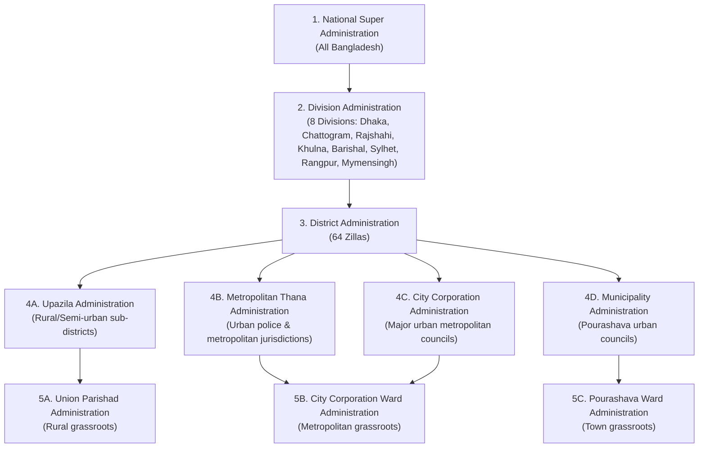

# LALBINDU — BANGLADESH ADMINISTRATIVE HIERARCHY & ID CARD SPECIFICATION

## 1. Bangladesh Administrative Realities

The platform models Bangladesh's genuine administrative structures accurately, avoiding generic or inaccurate assumptions:



---

## 2. Administrative Role Digital ID Card Palette & Branding

Every administrative tier features a distinctive visual identity, card typography, and security badge pattern:

| Administrative Tier | Card Template ID | Primary Color | Accent Color | Visual Identity Theme |
|---|---|---|---|---|
| **Super Admin** | `super_admin_card` | `#580F1A` (Deep Burgundy) | `#D4AF37` (Royal Gold) | Crest of National Honor |
| **Division Admin** | `division_admin_card` | `#0D3B66` (Royal Blue) | `#F4D35E` (Sunflower Gold) | Regional Command Ribbon |
| **District Admin** | `district_admin_card` | `#006A4E` (Emerald BD Green)| `#E8F5E9` (Mint Tint) | District Heritage Emblem |
| **Upazila Admin** | `upazila_admin_card` | `#D84A1B` (Terracotta Orange)| `#FFF3E0` (Peach Tint) | Local Coordination Pattern |
| **Thana Admin** | `thana_admin_card` | `#008080` (Deep Teal) | `#E0F2F1` (Teal Ice) | Metropolitan Grid Accent |
| **City Corp Admin**| `city_corp_card` | `#1B4931` (Dark Forest Green)| `#D4AF37` (Gold Accent) | Urban Megacity Crest |
| **Municipality Admin**| `municipality_card`| `#1D3557` (Navy Blue) | `#A8DADC` (Celeste) | Civic Seal Pattern |
| **Union Admin** | `union_card` | `#4A154B` (Imperial Purple) | `#F3E5F5` (Lavender Tint) | Grassroots Harmony |
| **Ward Admin** | `ward_admin_card` | `#9B111E` (Ruby Rose) | `#FFEBEE` (Rose Soft) | Community Guardian |
| **Registered Donor**| `donor_card` | `#C8102E` (LalBindu Red) | `#FFF5F6` (LalBindu Light) | Drop of Life & Blood Group |
| **Volunteer** | `volunteer_card` | `#006A4E` (Heritage Green) | `#E8F5E9` (Green Sheen) | Hands of Humanity |
| **Hospital Staff** | `hospital_staff_card`| `#1565C0` (Clinical Cobalt) | `#E3F2FD` (Medical Sky) | Caduceus & Cross Motif |

---

## 3. Strict Non-Governmental Disclaimer Policy

> **CRITICAL LEGAL NOTICE**:
> All LalBindu administrative ID cards and public verification pages explicitly display:
> *"LalBindu Appointed Volunteer Coordinator / Administrative Representative. This card signifies platform coordination authority within LalBindu and is NOT an official Government of the People's Republic of Bangladesh civil servant credential."*
> No official government crests, logos, or misleading sovereign emblems are utilized.

---

## 4. Verification & Social Sharing Architecture

```text
Physical/Digital Card (Contains QR Code)
               │
               ▼
Scan QR Code with Mobile Camera or In-App Scanner
               │
               ▼
Public Edge Route: https://lalbindu.bd/verify/[secure_token]
               │
               ▼
Display Redacted Verification Summary:
├── Cardholder Full Name & Photo
├── Role: District Administrator (Dhaka)
├── LalBindu Card ID: LB-CARD-ADM-DHAKA-04
├── Status: ACTIVE (Verified by National Secretariat)
├── Issued Date: 2026-01-15 | Expiry Date: 2027-01-14
└── (REDACTED: Phone, Email, National ID, Private Residence)
```

---
© 2026 LalBindu Administrative Governance Team.
