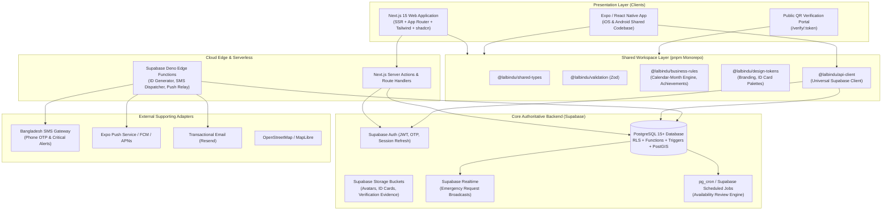

# LALBINDU — SYSTEM ARCHITECTURE DOCUMENT

## 1. High-Level Architectural Blueprint



---

## 2. Monorepo Organization & Directory Topology

```text
apps/
  ├── web/
  │   ├── app/
  │   │   ├── (public)/                 # Landing page, Find Donor, Requests, Campaigns, About, Contact
  │   │   ├── (auth)/                   # Login, Register, Verify-OTP, Reset-Password
  │   │   ├── (dashboard)/              # Authenticated Role Dashboards
  │   │   │   ├── donor/                # Donor Profile, History, Availability, Achievements, ID Card
  │   │   │   ├── requester/            # Blood Request Management & Inquiries
  │   │   │   ├── hospital/             # Hospital Portal, Donation Submissions, Staff
  │   │   │   ├── volunteer/            # Volunteer Tasks, Badges, Campaigns
  │   │   │   ├── admin/                # Regional, District, Upazila, Ward Administrative Suites
  │   │   │   └── super-admin/          # System-wide Settings, Role Grants, Audit Logs
  │   │   ├── verify/[token]/           # Public QR Verification Portal (Redacted PII)
  │   │   └── api/                      # Edge Webhook & Backend Handlers
  │   ├── components/                   # UI components, layout, navbar, footer, ID card canvas
  │   ├── lib/                          # Client-side Supabase SSR, i18n Bangla/English dictionaries
  │   └── public/                       # Favicons, assets, brand vectors
  │
  └── mobile/
      ├── app/                          # Expo Router routes
      │   ├── (auth)/                   # Welcome, Login, Register, OTP Verification
      │   ├── (tabs)/                   # Home, Find Donor, Blood Requests, My ID, Profile
      │   ├── request/[id].tsx          # Emergency blood request details & donor actions
      │   ├── scan/index.tsx            # Camera QR code scanner for ID verification
      │   └── settings/                 # Language (BN/EN), privacy, notification controls
      ├── components/                   # React Native UI elements & ID card previews
      └── lib/                          # SecureStore auth adapter, push notification handlers

packages/
  ├── shared-types/                     # Universal TypeScript types, database row models, enums
  ├── validation/                       # Zod validation schemas for forms, requests, and profiles
  ├── business-rules/                   # Availability calculation engine, achievement evaluators
  ├── api-client/                       # Supabase client singletons & typed queries
  └── design-tokens/                    # Brand tokens (#C8102E, #E31E36, #006A4E), ID card themes

supabase/
  ├── migrations/                       # Incremental PostgreSQL migrations with RLS policies
  ├── functions/                        # Edge Functions for sensitive operations
  ├── seed.sql                          # Complete Bangladesh administrative dataset + seeds
  └── tests/                            # Database integration & RLS privilege tests
```

---

## 3. Core Architectural Subsystems

### 3.1 Authentication & Multi-Role Identity
- **Single Source of Truth**: Connected to Supabase Auth (`auth.users`).
- **Flexible Login**: Bangladesh phone number (+880...) with OTP or Email & Password.
- **Multi-Role Capability**: A single individual can hold multiple concurrent roles (e.g., Donor + Volunteer + District Administrator).
- **Session Continuity**: Web utilizes `@supabase/ssr` cookies; Mobile leverages `expo-secure-store` with encrypted JWT tokens.

### 3.2 Bangladesh Administrative Hierarchy & Jurisdiction
- Models accurate Bangladesh geographical and civic hierarchy:
  1. **Division** (8 Divisions: Dhaka, Chattogram, Rajshahi, Khulna, Barishal, Sylhet, Rangpur, Mymensingh)
  2. **District** (64 Zillas)
  3. **Upazila** (Sub-districts) & **Metropolitan Thana** (distinct city police jurisdictions)
  4. **Union Parishad**, **Municipality (Pourashava)**, and **City Corporation Wards**
- **Jurisdiction-Scoped RBAC**: An Upazila Administrator can view and manage donors/requests strictly inside their assigned upazila. Super Admin retains national oversight.

### 3.3 Donor Availability Engine (Calendar-Month Arithmetic)
- Whole blood donation enforces a mandatory 3-calendar-month platform pause.
- Uses `Asia/Dhaka` timezone arithmetic (e.g., donation on Nov 30 -> review date Feb 28/29; donation on Jan 31 -> review date Apr 30).
- Automatic state machine:
  `Available` -> `Temporarily Unavailable` -> `Needs Confirmation` -> `Available` (after donor checks in).
- Medical disclaimer: The platform pause is an administrative coordination rule, never an automated clinical fitness clearance.

### 3.4 Universal Digital ID Card & QR Verification
- Generates cryptographic, non-sequential verification tokens (e.g., `LB-V-XXXXXXXXXXXX`).
- Role-specific colorways and layouts (Donor, Super Admin, Division Admin, District Admin, Hospital Staff, Volunteer, etc.).
- Public `/verify/:token` route displays cardholder name, photo, role, jurisdiction, verified status, and issuance/expiry date. Redacts all sensitive personal details (phone, email, exact residence).

### 3.5 Emergency Blood Request & Donor Matching
- Requesters submit verified hospital requirements (blood group, units, location, required time, urgency).
- Matching engine identifies matching donors who:
  - Match compatible blood groups.
  - Reside in or near the requested hospital jurisdiction.
  - Are currently marked `Available`.
  - Have consented to emergency notifications.
- Donor responses: `Interested`, `Accept Contact Request`, `Decline`, `Not Available`. Phone numbers are only shared upon explicit donor confirmation.

---
© 2026 LalBindu Architectural Specification.
