# LALBINDU — DATABASE ENTITY RELATIONSHIP DIAGRAM (ERD)

```mermaid
erDiagram
    %% Authentication & Core Identity
    AUTH_USERS ||--|| PROFILES : "1:1 identity"
    PROFILES ||--o{ USER_ROLE_ASSIGNMENTS : "holds"
    ROLE_DEFINITIONS ||--o{ USER_ROLE_ASSIGNMENTS : "assigned in"
    ROLE_DEFINITIONS ||--o{ ROLE_PERMISSIONS : "contains"
    PERMISSIONS ||--o{ ROLE_PERMISSIONS : "granted to"

    %% Administrative Hierarchy & Jurisdictions
    ADMINISTRATIVE_UNIT_TYPES ||--o{ LOCATIONS : "categorizes"
    LOCATIONS ||--o{ LOCATIONS : "parent-child hierarchy"
    PROFILES ||--o{ ADMINISTRATIVE_ASSIGNMENTS : "assigned as admin"
    ROLE_DEFINITIONS ||--o{ ADMINISTRATIVE_ASSIGNMENTS : "admin rank"
    LOCATIONS ||--o{ ADMINISTRATIVE_ASSIGNMENTS : "jurisdiction bounds"

    %% Donor Domain
    PROFILES ||--o| DONOR_PROFILES : "donor details"
    LOCATIONS ||--o{ DONOR_PROFILES : "resides in"
    DONOR_PROFILES ||--o{ DONOR_AVAILABILITY_EVENTS : "state history"
    DONOR_PROFILES ||--o{ DONATION_RECORDS : "donates"
    DONATION_TYPES ||--o{ DONATION_RECORDS : "classified as"
    ORGANIZATIONS ||--o{ DONATION_RECORDS : "conducted at"

    %% Universal ID Cards
    ROLE_DEFINITIONS ||--o{ ID_CARD_TEMPLATES : "defines style for"
    PROFILES ||--o{ ID_CARDS : "possesses"
    ID_CARD_TEMPLATES ||--o{ ID_CARDS : "rendered using"
    ID_CARDS ||--o{ ID_CARD_VERIFICATIONS : "logged scans"

    %% Achievements
    ACHIEVEMENT_DEFINITIONS ||--o{ ACHIEVEMENT_AWARDS : "milestone criteria"
    PROFILES ||--o{ ACHIEVEMENT_AWARDS : "awarded to"

    %% Emergency Requests & Matches
    PROFILES ||--o{ BLOOD_REQUESTS : "requested by"
    LOCATIONS ||--o{ BLOOD_REQUESTS : "hospital location"
    BLOOD_REQUESTS ||--o{ REQUEST_MATCHES : "triggers"
    DONOR_PROFILES ||--o{ REQUEST_MATCHES : "matched donor"

    %% Organizations & Campaigns
    ORGANIZATIONS ||--o{ ORGANIZATION_MEMBERSHIPS : "enrolled in"
    PROFILES ||--o{ ORGANIZATION_MEMBERSHIPS : "staff/member"
    ORGANIZATIONS ||--o{ CAMPAIGNS : "organizes"
    LOCATIONS ||--o{ CAMPAIGNS : "held at"

    %% Governance & Auditing
    PROFILES ||--o{ AUDIT_LOGS : "performed by"
    PROFILES ||--o{ CONSENT_RECORDS : "acknowledged by"
```

---

## Relationship Integrity Rules

1. **User Identity Continuity**: All roles, profiles, donor histories, and digital cards reference `profiles.id` which maps to Supabase `auth.users(id)`. No orphan records are possible.
2. **Jurisdiction Scoping**: `administrative_assignments` enforces that non-Super-Admin privileges are constrained strictly to the assigned `locations.id` and its recursive descendants.
3. **Audit Immutability**: `audit_logs`, `donor_availability_events`, and `id_card_verifications` do not support `UPDATE` or `DELETE` operations under any circumstance.
4. **Achievement Integrity**: `achievement_awards` enforces `UNIQUE(user_id, achievement_id)` to prevent double-awarding of badges.
5. **Card Verification Security**: Every `id_cards` row generates a unique non-sequential verification token. Public lookups use token hashes to prevent brute-force enumeration.

---
© 2026 LalBindu Database Engineering Team.
